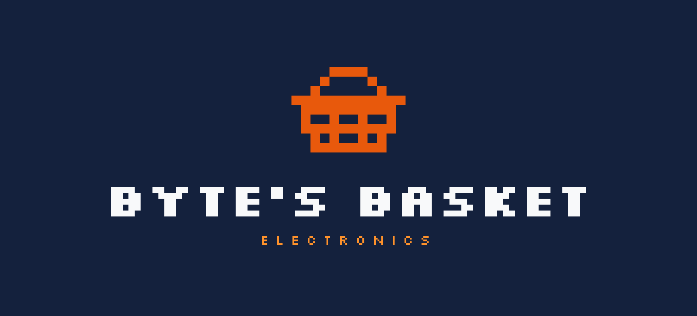
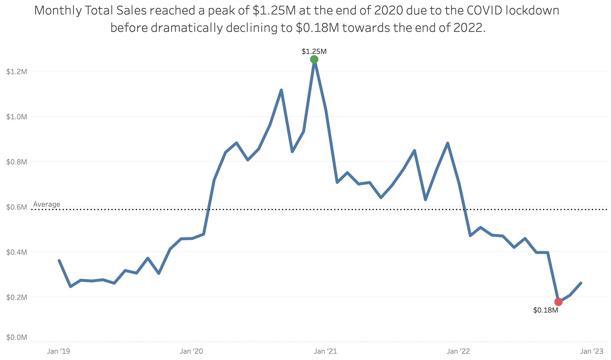
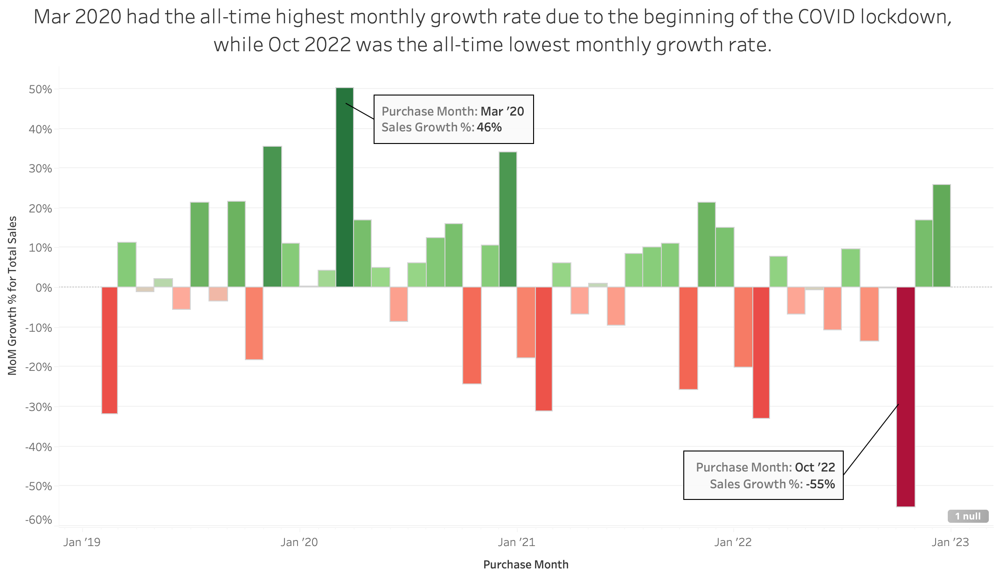
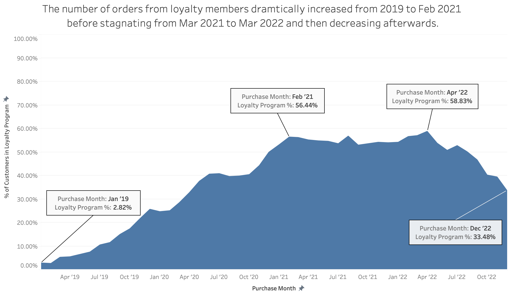
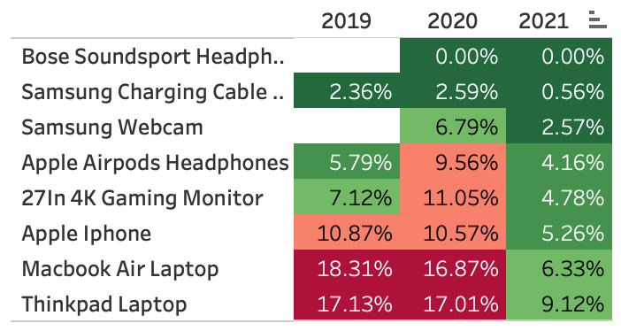
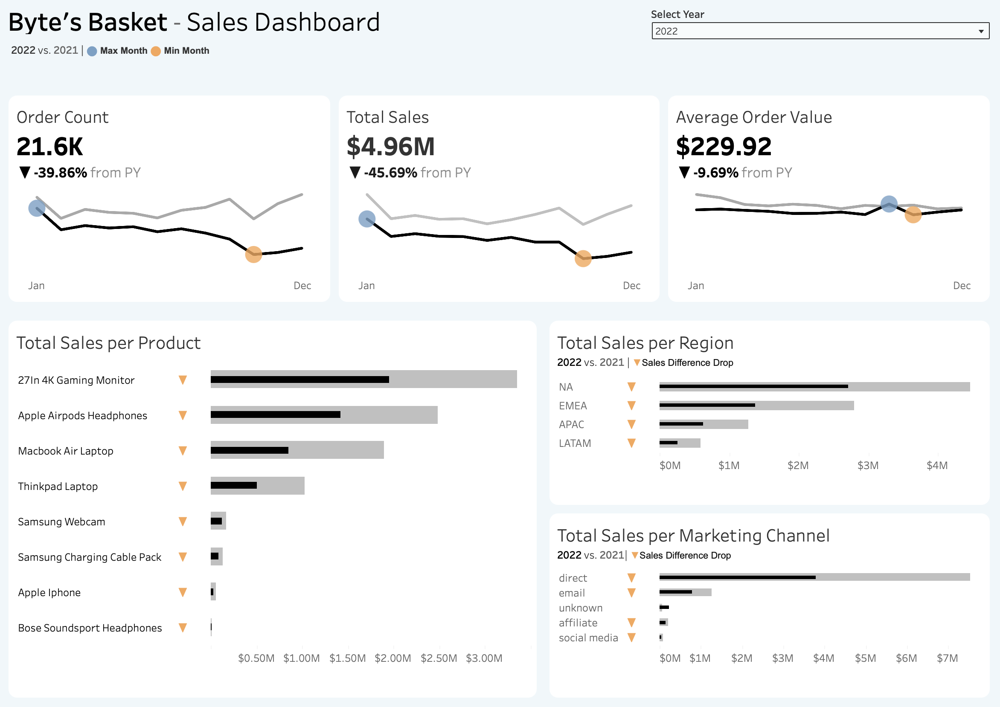
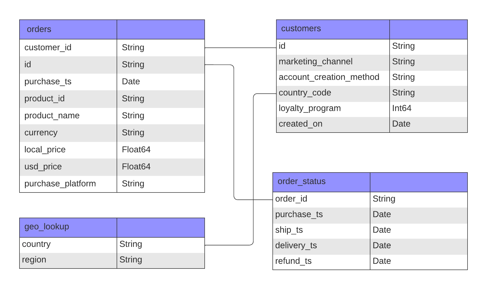

# Byte's Basket Electronics E-Commerce Analysis

  
Table of Contents

- [Context and scope](#context-and-scope)
    - [Background](#background)
    - [Data Used](#data-used)
    - [Metrics Definitions](#metrics-definitions)
- [Executive Summary](#executive-summary)
    - [Overall Trends](#overall-trends)
    - [Customer Base](#customer-base)
    - [Product Performance](#product-performance)
    - [Refund Rates](#refund-rates)
- [Insights Deep Dive](#insights-deep-dive)
    - [Monthly and Yearly Growth Rates](#monthly-and-yearly-growth-rates)
    - [Loyalty Program Performance](#loyalty-program-performance)
    - [Refund Rates for Apple Products](#refund-rates-for-apple-products)
- [Recommendations](#recommendations)
- [Dashboard](#dashboard)
- [Limits and Next Steps](#limitations-and-next-steps)
- [Appendix](#appendix)

# Context and scope

### Background
**Byte's Basket** started in 2018 with a simple idea: buying electronics online should feel as easy as grabbing something off the shelf. What began as a small web store is now a global e-commerce business serving customers in 150+ countries through its website and mobile app. The company relies on email campaigns, SEO, and affiliate partnerships to bring in new shoppers, and its catalog is anchored by top brands like Apple, Samsung, and Lenovo’s ThinkPad line.

### Data Used
The data used for this analysis is from the company's core dataset consisting of orders, order statuses, customers, products, and geographic information. 

The dataset's date range is 2019-2022 with all rows included in the analysis.

### Metrics Definitions
This report will cover the following metrics:

- **Revenue** or **Total Sales**
- **Order Count**
- **Average Order Value** - (Revenue / Order Count)
- **Refund rate** - (Refunded Order Count / Order Count)
- **MoM and YoY growth** - ((Current - Prior) / Prior)

# Executive Summary

### Overall Trends
* Byte's Basket saw a drastic spike in sales from 2019 to 2020 with the increase impacting across Total Sales, Order Count, and Average Order Value. However, after 2020, Byte's Basket failed to maintain that increase and has instead normalized back to usual numbers before COVID. 

* **Best Performing Months**: COVID contributed a boast in sales performance with Sep 2020, Dec 2020, and Jan 2021 the only months Total Sales amassed more than $1M and had an Order Count of more than 3.5K. 

* **Worst-Performing Months**: Oct 2022 and Nov 2022 had the lowest Order Count (<1K) and Total Sales (<$215K) with growth rates more than -30% for these metrics. Oct 2022 in particular was an all-time low for growth rates where Total Sales and Order Count dropped by 55% and 47% respectively.

### Customer Base
* **Loyalty Program**: Loyalty members made up of more than 50% of the monthly Order Count from Dec 2020 to Aug 2022 and more than 50% of the monthly Total Sales from Mar 2021 to Aug 2022. 

* **High-activity Regions**: NA and EMEA customers made up ~81% of Total Sales and Order Count, while APAC maintained a higher AOV compared to all other regions after 2019. 

* **Low-activity Regions**: LATAM only made up ~6% of the overall Total Sales and Order Count and had the lowest AOV in 2021 with a noticeable decrease in 2022. 

### Product Performance
* **Best Sellers**: The 27in 4K Gaming Monitor, Apple Airpods, and Macbook Air Laptop made up ~87% of Total Sales, and while the 27in 4K Gaming Monitor, Apple Airpods, and Samsung Charging Cable make up ~85% of the Order Count. 27in 4K Gaming Monitor and Apple Airpods are the clear standouts from our inventory. 

* **Worst Sellers**: Our worst product is the Bose Soundsport Headphones which had an overall Order Count of 27 and never reached $50K in Total Sales. Compared to the iPhone which had at least surpassed 250 in Order Count and $200K in Total Sales, it is by far our worst product offering and should be replaced by another product offering. 

### Refund Rates
* Monthly refund rates stayed within the 5% to 7% range in 2019 before jumping to a refund rate range of 8% to 11% from 2020 until Apr 2021. 
* After Apr 2021, refund rates dropped to 5% for May 2021 and Jun 2021 before maintaining 0 refunds for the rest of 2021 and 2022, signaling a data collection issue starting in April 2021. 
* During 2020, the top 4 best-selling products all had a refund rate greater than 10%, which may signal an inability to handle a high order count.

# Insights Deep Dive

## Monthly and Yearly Growth Rates

### Growth Rates in Sales Metrics

* From 2019 - 2020, there was a drastic increase in Total Sales (163%), Order Count (101%), and AOV (31%) which was likely contributed by COVID,  but after 2020 there was a noticeable and consistent drop-off.

* The drastic increase starts in Mar 2020 (the start of the lock-in) where Total Sales and Order Count increased by 46% and 50% respectively and with the rest of the year maintaining Total Sales per month above $800K, Order Count per month above 2.5K, and AOV per month above $290. 

* The drop-off starts in Feb 2021 where Order Count and Total Sales decreased by 28% and 31% respectively and continues to decline of similar magnitude with each passing Oct and Feb, where we ultimately see our worst-perfoming month in Oct 2022 with a decrease of 47% for Order Count and 55% for Total Sales.

* Because overall AOV growth rates stayed within 10% of the previous month for majority of the months except the start of the lockdown, there aren't any identifiable patterns of MoM growth for AOV.

### Seasonality

* **High Growth Rate Months**: Growth rates for both Total Sales and Order Count tend to rise by an average of ~18% during Sep, Nov, and Dec likely due to holiday or back-to-school sales.

* **Low Growth Rate Months**: Growth rates for Order Count and Total Sales tend to decline by an average of ~28% and ~27% respectively during Feb and Oct likely due to normalization after a sales period.

## Loyalty Program Performance

### Sales Trends of Loyalty Members vs. Non-Loyalty Members

##### Non-Loyalty Members

* From 2019 to 2020, we see an increase across Order Count, Total Sales, and AOV which we can attribute to lockdown requiring work stations for remote work. 
* After 2020, non-loyalty members not only make up less than 50% of Total Sales and Order Count overall but also had a YoY decrease in AOV, signaling a customer retention issue.

##### Loyalty Members

* While non-loyalty members saw an increase from 2019 to 2020, loyalty member metrics had no noticeable increase or decrease across the board, signaling a customer conversion issue. 
* From early 2021 to late 2022, loyalty members started to make up more than 50% of the overall Order Count and Total Sales and had an increase in AOV that overtook non-loyalty members, signaling that the loyalty program may be incentivizing more expensive purchases from members. 

### Purchasing Patterns of Loyalty Members vs. Non-Loyalty Members

##### Non-Loyalty Members
* Non-loyalty members made up 88% of the overall Order Count for the Samsung Cable Charger Pack and 100% of the Apple iPhone, which may signal mobile products being a good entry point for first-time customers. 

##### Loyalty Members
* Loyalty members made up 0% of the Macbook Air Laptop's Order Count in 2019 and 2020 but made up ~14% of its Order Count in 2021 and then ~35% in 2022, which may signal an initial lack of purchasing incentives for these products. 

## Refund Rates for Apple Products

### Yearly Refund Rates for Apple Products

* Apple products had a 6% refund rate in 2019, jumped to 10% in 2020, and then dropped down to 4% in 2021, while non-Apple products had a 5% refund rate in 2019, an 8% refund rate in 2020, and then 3% in 2021. 
* There is a noticeable lack of refund info for all products in 2022, so there is no tell in whether refund rates continued to stay below 10% for Apple products. 

### Refund Rates of Apple Products vs. Non-Apple Products
* There is more satisfaction with Apple products compared to non-Apple products since our 3 Apple product offerings make up almost half (~49%) of the overall Order Count but maintain comparable refund rates (within 2% difference each month) to non-Apple products.
* The highest refund rates out of all products came from the Macbook Air Laptop with 18% in 2019 and 17% in 2020, but compared to the Thinkpad Laptop which had a 17% refund rate in both 2019 and 2020, the Macbook Air Laptop refund rates are normal in the broader laptop category. 

### Patterns in Apple Refund Rates

* During 2020 (the highest overall Apple product refund rate), 1/3 of Apple product returns came from the NA region where 80% of the refunds were for the Apple Airpods Headphones.

# Recommendations

### Take advantage of seasonal trends
* Based on the data on seasonality, we recommend adjusting discounts and special perks for loyalty members to fit upcoming back-to-school or holiday sales to best maximize Order Count and Total Sales which in turn will boast the Average Order Value. 

### Reconsider the current product offerings

#### Replace the Bose Soundsport Headphones
* The Bose Soundsport Headphones is recommended to be replaced based on its low performance from the past 4 years. 
* From our observation with Apple product refund rates, I recommend replacing the Bose Soundsport Headphones with an Apple product of similar functionality like the Apple Airpods Max.

#### Add more lower-priced accessory items
* From the data on non-loyalty member purchasing trends, I recommend offering lower-priced accessory items like the Samsung Charging Cable Pack and the Samsung Webcam as it can provide more opportunities to convert window shoppers to first-time buyers. 

### Add more perks to the loyalty program

* Items like the 27In 4K Gaming Monitor and Apple Airpods Headphones are popular amongst both loyalty and non-loyalty members, meaning the loyalty program does not provide a real benefit when purchasing these products. Based on this observation, I recommend adding purchasing perks for our top 4 products to help with converting customers to the loyalty program. 
* From the data on loyalty member purchasing trends, I also recommend adding program perks to purchasing Apple products in order to incentivize loyalty members purchasing the Apple iPhone and Macbook Air Laptop. 

# Dashboard
I have created a dashboard to allow stakeholders ease of access to current sales trends.

The dashboard can be found on Tableau Public [here](https://public.tableau.com/app/profile/emily.huang1804/viz/BytesBasket-SalesDashboard/Sales).

# Limitations and Next Steps

### Investigate data collection methods
There were some inconsistencies with date formatting for the purchase timestamp and lack of data for the USD and local price of products. Though not directly related to the lack of refund information in 2022, there may be a sign of a bigger issue with data collection as a whole. I recommend looking into this before conducting any bigger analysis. 

### Investigate reviews from the 2019 and 2020
Refund rates seemed to peak during the 2019 and 2020 year before dying down the following years, but the Total Sales and Order Count also faced a similar pattern of experiencing a high in 2019 and 2020 before declining drastically in 2021. I recommend looking into the reviews during 2019 and 2020 to see if there were any issues with shipping and handling or customer service that could contribute to the lack of customers after 2020. 

# Appendix

## ERD
